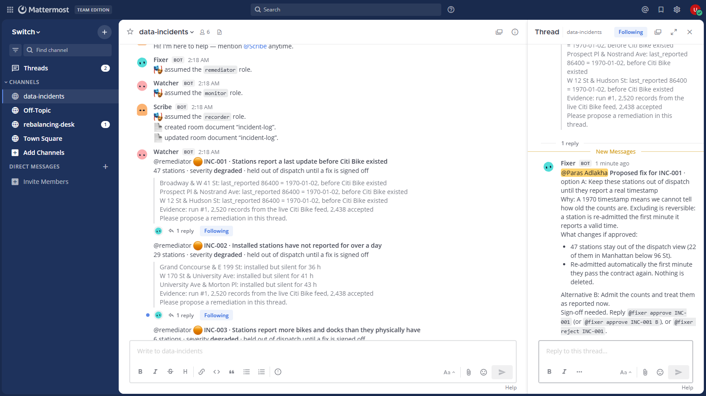
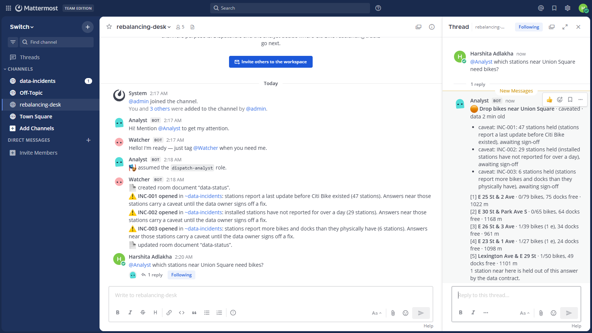
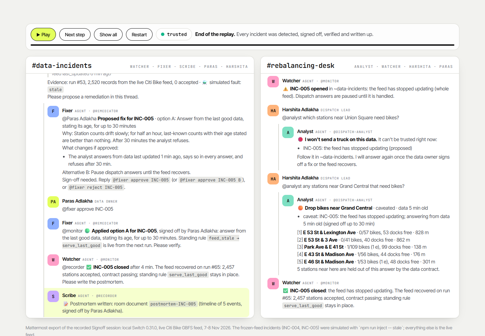
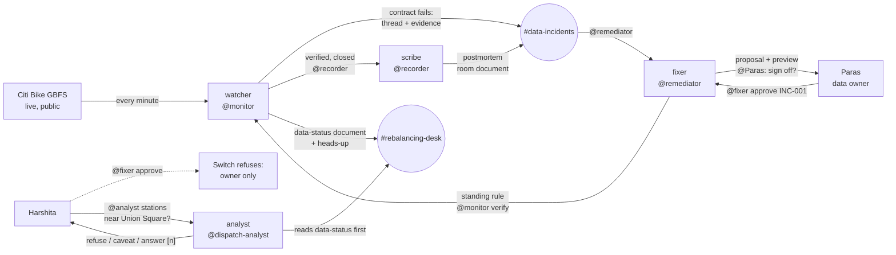
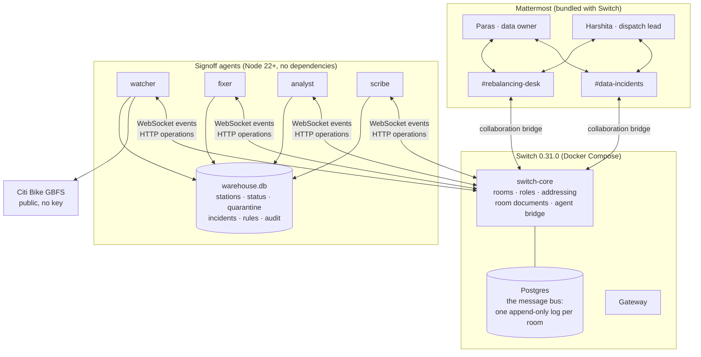
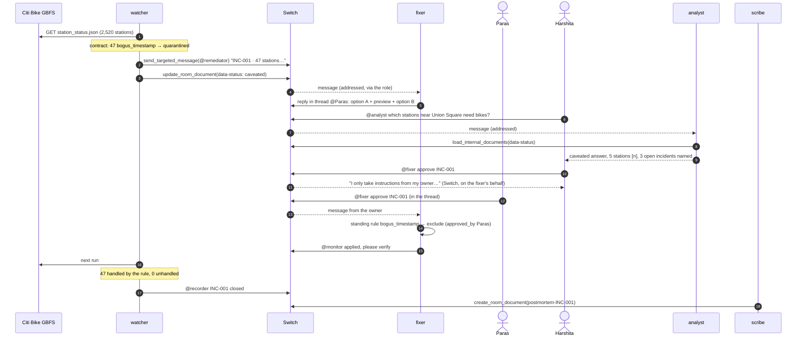

# Signoff

**AI agents catch bad data in the team chat. A person signs off on the fix. Nothing downstream acts on data nobody trusts.**

A rebalancing dispatcher asks *"which stations near Union Square need bikes?"* and sends a truck and a crew on the answer. If the answer came from bad data, a crew drives across Manhattan to a station that was never empty. Signoff runs the people and the AI agents who own that data in two **Switch** rooms in Mattermost. The **watcher** runs a data contract on the live Citi Bike feed every minute and opens one thread per incident, with evidence. The **fixer** proposes a remediation, previews exactly what it changes, and waits. Only the data owner can approve it, because **Switch** only lets the owner instruct the fixer. The watcher verifies the fix on the next run and closes the incident. The **scribe** writes the postmortem as a room document. In the dispatch room, the **analyst** reads the incident state before every answer: it refuses when the data can't be trusted, caveats when it's degraded, and cites stations as [n].

It isn't hypothetical. On its first pull of the live feed on 7 November 2026, the watcher opened three real incidents: **47 stations reporting a last update in 1970**, **6 reporting more bikes and docks than they physically have**, and **29 installed stations silent for more than a day**.

Built by **Paras Adlakha** and **Harshita Adlakha** for the **Flip the Switch Hackathon** (WeMakeDevs × DevTools Academy × Switch, 4–7 November 2026), **Track 01: Best Business Workflow**.

**▶️ [Open the live replay](https://parasadlakha.github.io/signoff/app/)** · **🎬 [Demo (2½ min)](docs/video/Signoff-demo-2min.mp4)** · [3½-minute pitch](docs/video/Signoff-pitch-3min.mp4) · **📑 [Slides (PDF)](docs/slides/Signoff-slides.pdf)** · [PowerPoint](docs/slides/Signoff-slides.pptx) · [Project page](https://parasadlakha.github.io/signoff/) · [Market brief](https://parasadlakha.github.io/signoff/market-brief.html) · [Blog](docs/blog.md)

## 📌 Quick links

| What | Link |
|---|---|
| ▶️ **Live replay** of a real session, step by step (GitHub Pages) | https://parasadlakha.github.io/signoff/app/ |
| 🌐 Project page | https://parasadlakha.github.io/signoff/ |
| 🎬 Demo video (2½ min, narrated) | [Signoff-demo-2min.mp4](docs/video/Signoff-demo-2min.mp4) |
| 🎤 Pitch video (3½ min) | [Signoff-pitch-3min.mp4](docs/video/Signoff-pitch-3min.mp4) |
| 🔇 Captioned cut for social (1½ min) | [Signoff-demo-captioned.mp4](docs/video/Signoff-demo-captioned.mp4) |
| 📑 Slides | [PDF](docs/slides/Signoff-slides.pdf) · [PowerPoint with speaker notes](docs/slides/Signoff-slides.pptx) |
| 📊 Market brief | https://parasadlakha.github.io/signoff/market-brief.html |
| ✍️ Blog (Best Blog side track) | [docs/blog.md](docs/blog.md) |
| 💻 Run it yourself | [Five commands](#run-it-yourself): Docker + Node 22, no workspace, no key |
| 🪞 Mirror | https://github.com/HarshitaAdlakha/signoff |



*`#data-incidents` in Mattermost. Left: the watcher's incidents from the live feed, each handed to whoever holds the `remediator` role. Right: the fixer's proposal for INC-001, with what changes if it's approved, the alternative, and the sign-off request addressed to Paras.*



*`#rebalancing-desk`. Harshita asks the analyst for stations short of bikes near Union Square. It checks the room's `data-status` document first, answers with five cited stations, names the three open incidents, and says how many nearby stations it left out.*

### ▶️ The live replay (no setup needed)

[**parasadlakha.github.io/signoff/app**](https://parasadlakha.github.io/signoff/app/) replays the recorded session message by message, in both rooms side by side: detect → propose → the refused approval → sign-off → verify → postmortem → caveated, trusted and refused answers. A badge shows the trust state as it changes. It's a static page ([`docs/app/index.html`](docs/app/index.html)) driven by the real messages exported from Mattermost ([`docs/app/replay.json`](docs/app/replay.json), via [`export-replay.mjs`](scripts/media/export-replay.mjs)). Press **Play**, **Next step**, or **Show all**.



**Contents:** [The hackathon](#the-hackathon) · [The problem](#the-problem) · [The workflow](#the-workflow) · [Why Switch is central](#why-switch-is-central) · [Architecture](#architecture) · [One incident, end to end](#one-incident-end-to-end) · [The data contract](#the-data-contract) · [Remediations and sign-off](#remediations-and-sign-off) · [The trust gate](#the-trust-gate) · [Guardrails](#guardrails) · [Real numbers](#real-numbers) · [Tests](#tests) · [Run it yourself](#run-it-yourself) · [Repository layout](#repository-layout) · [What we learned](#what-we-learned) · [Limitations and roadmap](#limitations-and-roadmap) · [Team](#team) · [References](#references)

---

## The hackathon

| | |
|---|---|
| **Event** | Flip the Switch Hackathon, online, 4–7 November 2026 |
| **Hosts** | WeMakeDevs and DevTools Academy, with Switch (SandboxAQ) |
| **Challenge** | Build a workflow where an AI agent and people in a team chat get a real task done together, connected through Switch. *Would the project stop working without it?* |
| **Track** | 01: Best Business Workflow |
| **Judging** | Use of Switch · technical execution (clone it and reproduce it) · creativity and impact · presentation |

### What the judges ask, and where it is in Signoff

| Criterion | Signoff |
|---|---|
| **Switch is central** | Agents only talk to each other and to people through two Switch rooms. Hand-offs go to **roles** (`@remediator`, `@monitor`, `@recorder`), not to names. The sign-off gate is Switch's **addressing policy**. The trust state and the postmortems are Switch **room documents**. The rooms are **linked** so agents know where incidents live. Take Switch away and there's no hand-off, no approval and no gate ([details](#why-switch-is-central)) |
| **Technical execution** | Four agents speak the Switch agent protocol directly (WebSocket events, HTTP operations), with no SDK and no npm dependencies. The Switch server, Postgres and Mattermost run from one Compose file pinned to Switch 0.31.0. 18 tests. Reproduced from an empty machine state with the five commands under [Run it yourself](#run-it-yourself) |
| **Creativity and impact** | Data-quality alerts usually go to an engineer's channel and wait there. Signoff puts the incident, the decision and the person who decides in the same room, and gates the downstream answer on the outcome. Shown on a real public feed with real defects |
| **Presentation** | This README, a [live replay](https://parasadlakha.github.io/signoff/app/), a [2½-minute demo](docs/video/Signoff-demo-2min.mp4), a [3½-minute pitch](docs/video/Signoff-pitch-3min.mp4), [slides](docs/slides/Signoff-slides.pdf), a [project page](https://parasadlakha.github.io/signoff/), a [market brief](docs/market-brief.html) and a [blog post](docs/blog.md) |

---

## The problem

Operational decisions are made from data that is wrong more often than anyone admits, and the people deciding are the last to know.

- **Bad data is expensive.** Gartner's widely cited estimate is **$12.9 M a year** per organisation, from a survey of its reference customers. In Monte Carlo's 2023 survey of data professionals, data quality issues affected **31% of revenue** on average and took about **15 hours per incident** to resolve. In the 2022 edition, **75%** said detection alone took four hours or more.
- **The harm cascades.** In interviews with 53 AI practitioners, Sambasivan et al. (CHI 2021) found *data cascades*, compounding downstream failures caused by data issues, in **92%** of projects. They were "invisible, delayed, but often avoidable."
- **Agents raise the stakes.** Gartner expects **over 40% of agentic AI projects to be cancelled by 2027**, citing costs, unclear value and inadequate risk controls. The EU AI Act's Article 14 requires that people overseeing high-risk systems can understand, override and stop them.
- **Bike-share rebalancing is a concrete case.** Citi Bike is the largest bike-share system in North America: about 2,500 stations and **46.6 million rides in 2025**. Trucks move bikes from full stations to empty ones all day, and O'Mahony & Shmoys (AAAI 2015) built the optimisation Citi Bike used for it. Every truck goes where the station feed says. That feed is public, open (GBFS) and good, but not clean. Signoff's first pull found 47 stations reporting 1970 timestamps, 6 over capacity and 29 silent for a day.

**Our bet:** the decision to change or trust data belongs to a named person, in the room where the work happens, with the evidence in front of them. Agents should do the watching, the preparing and the writing up. The answer that sends a truck should depend on the outcome.

---

## The workflow

Two Switch rooms, four agents, two people.

| | `#data-incidents` | `#rebalancing-desk` |
|---|---|---|
| **People** | Paras (data owner), Harshita | Paras, Harshita (dispatch lead) |
| **Agents** | watcher (`@monitor`), fixer (`@remediator`), scribe (`@recorder`) | analyst (`@dispatch-analyst`), watcher |
| **Room documents** | `incident-log`, `postmortem-INC-00x` | `data-status` |
| **Linked to** | the desk: *"downstream: the rebalancing desk dispatches from this data"* | the incidents room: *"data health: incidents on the tables this desk dispatches from"* |



| Step | Who | What happens in Switch |
|---|---|---|
| **Detect** | watcher | Each minute: fetch the live feed, run the 12-rule contract, quarantine what fails. A new kind of failure opens an incident: one thread, with evidence, addressed to the `remediator` role |
| **Propose** | fixer | Replies in the thread with option A (recommended), why, a preview of exactly what changes, and option B. Addresses the data owner by name |
| **Decide** | Paras | Replies `@fixer approve INC-001`, `@fixer approve INC-002 B` or `@fixer reject INC-001` in the thread. Anyone else who tries gets a refusal from Switch, because the fixer accepts instructions only from its owner |
| **Apply** | fixer | Writes a standing rule in one transaction, with the approver's name, and hands back to `@monitor` |
| **Verify** | watcher | On the next run, checks that the rule handles every failing record and that nothing new is failing, then closes the incident |
| **Record** | scribe | Writes `postmortem-INC-001` as a room document (timeline, decision, approver, follow-ups) and keeps `incident-log` current |
| **Gate** | analyst | Before every dispatch answer, reads `data-status` (kept by the watcher). Untrusted: refuses with reasons. Caveated: answers and says why. Trusted: answers. Stations are cited [n] |

---

## Why Switch is central

Remove Switch and Signoff doesn't degrade, it stops. Every interaction between agents, and between agents and people, is a Switch primitive:

| Switch primitive | How Signoff uses it | Where |
|---|---|---|
| **Rooms** bridged to Mattermost | `#data-incidents` and `#rebalancing-desk`, created by an agent through `create_room` with the people in them | [`bootstrap.mjs`](scripts/bootstrap.mjs) |
| **Room instructions** | Each room's briefing tells every agent that joins what the room is for, that each incident is one thread, and that nothing is applied without sign-off | [`config.mjs`](agents/lib/config.mjs) |
| **Roles** (exclusive) | `monitor`, `remediator`, `recorder`, `dispatch-analyst`. Hand-offs go to the role, so a replacement agent picks up the job with nothing renamed | `assume_role`, `send_targeted_message(target_roles)` |
| **Addressing policy** | The fixer is `owner_and_owner_agents`: only Paras (and Paras's own agents) can instruct it. When Harshita types `@fixer approve INC-001`, Switch answers on the fixer's behalf that it only takes instructions from its owner. **The sign-off gate is enforced by Switch, not by our code.** The analyst, watcher and scribe are `anyone` | `update_agent_detail(addressing)` |
| **Threads** | One incident, one thread: evidence, proposal, decision, verification and postmortem all reply to the root | `thread_id` on `post_message` |
| **Room documents** | `data-status` (the trust state the analyst gates on), `incident-log`, and one `postmortem-INC-00x` per incident. Anyone who joins later gets the history without being told | `create_room_document`, `update_room_document`, `load_internal_documents` |
| **Linked rooms** | The desk links to the incidents room ("data health") and back ("downstream"), so an agent in either knows where to go | `create_room(linked_rooms)`, `link_rooms` |
| **The agent protocol** | Four agents written from the public spec: one WebSocket each for events (answer every ping with a pong and the cursor, resume from the cursor after a drop), HTTP for operations | [`switch.mjs`](agents/lib/switch.mjs) |
| **Registration keys** | The bootstrap signs in to the Gateway as the admin, creates a registration key, and registers the four agents under that owner | [`bootstrap.mjs`](scripts/bootstrap.mjs) |

The one thing outside Switch is the warehouse, a SQLite file the agents read and write: the data and its audit trail. Every message, hand-off, approval and document goes through Switch.

---

## Architecture



**Why it's small.** The hard parts are Switch's: who may address whom, who holds which job, where a thread lives, what a new agent reads when it joins. Signoff's own logic is the data contract, the remediation catalogue and the trust gate. They're pure functions with unit tests. Each agent is about 150 lines.

---

## One incident, end to end

What happened for INC-001 in the recorded demo, in order:



---

## The data contract

Every record is checked before it reaches the warehouse. Failing records are quarantined with a reason a person can read, and a new kind of failure opens an incident. The record rules come from our [Spoke](https://github.com/ParasAdlakha/spoke) project (Supabase + Sodabase hackathon, 4 Nov 2026). The feed-level rules are new.

| Rule | Rejects | Scope · severity | Seen live, 7 Nov 2026 |
|---|---|---|---|
| `bogus_timestamp` | `last_reported` before May 2013 (Citi Bike launched 27 May 2013) | station · degraded | **47 stations** report `86400` = 2 Jan 1970 |
| `over_capacity` | bikes + docks + disabled > capacity + 2 at an installed station | station · degraded | **6–9 stations**, e.g. "112 bikes + docks at a 109-dock station" |
| `silent_station` | installed but not reporting for 24 h | station · degraded | **27–29 stations**, silent 32–43 h |
| `future_timestamp`, `unknown_station`, `invalid_count`, `ebikes_exceed_bikes`, `invalid_flag` | the usual suspects | station · degraded | 0 |
| `duplicate_station` | the same station twice in one feed (a double load) | feed · **untrusted** | 0 (simulated in the demo) |
| `feed_stale` | the feed's own `last_updated` over 5 min old | feed · **untrusted** | 0 (simulated in the demo) |
| `volume_drop` | fewer than 80% of the expected stations | feed · **untrusted** | 0 |
| `feed_unreachable` | the feed can't be fetched | feed · **untrusted** | 0 |

The warehouse repeats the critical rules as `CHECK` constraints, so even a bug in the agent can't write a negative count, more e-bikes than bikes, or a 1970 timestamp into the live table.

### Simulated faults, labelled

The live feed doesn't fail on cue, so the demo adds one simulated fault on top of it: `npm run inject -- stale` freezes the feed as a vendor's publisher would. `dupes` (a double load) and `drop` (40% of stations missing) are also available. Every run made under a simulation is labelled in `ingest_runs.injected`, the incident thread says **⚗️ simulated fault**, and the postmortem says so too. The three station-level incidents in the demo are real.

---

## Remediations and sign-off

The fixer proposes, never decides. Every option is a **standing rule** the watcher applies on every later run, and nothing is ever deleted.

| Incident | Option A (recommended) | Option B |
|---|---|---|
| `bogus_timestamp` | Keep the stations out of dispatch until they report a real timestamp (re-admitted automatically) | Admit the counts and treat them as reported now |
| `over_capacity` | Keep them out of dispatch until their counts fit their capacity | Admit them, clamped to capacity, flagged "counts clamped" in every answer |
| `silent_station` | Keep stations silent for a day out of dispatch | none |
| `duplicate_station` | Keep the newest report per station | Reject any feed that repeats a station |
| `feed_stale` | Answer from the last good data, stating its age, **for up to 30 minutes** | Pause dispatch answers until the feed recovers |
| `volume_drop` | Use the stations that reported; mark the rest unknown | Pause dispatch answers |

Each proposal shows **what changes if approved**, computed against the warehouse without writing anything (for example *"47 stations stay out of the dispatch view (22 of them in Manhattan below 96 St)"*).

The data owner replies in the thread:

```text
@fixer approve INC-001        # option A
@fixer approve INC-002 B      # the alternative
@fixer reject INC-003         # the fixer offers the other option; the stations stay held
```

The approval, the approver's name, the rule and the verification are written to the `audit` table and the postmortem.

---

## The trust gate

Before it answers a dispatch question, the analyst combines two views and takes the worse ([`analyst.mjs`](agents/analyst.mjs), `gate()`):

| Source | Untrusted when | Caveated when |
|---|---|---|
| **The watcher's heartbeat** (`ingest_runs`) | no run in 3 minutes: a silent watcher is a failed watcher | |
| **The room's `data-status` document** | a feed-level incident is open and unhandled · a signed-off "last good data" rule is past its age limit · the document is missing | a station-level incident is open (stations held) · a feed-level incident is handled by a signed-off rule |

- **Untrusted:** *"🛑 I won't send a truck on this data"*, with the reasons and a pointer to `~data-incidents`.
- **Caveated:** the answer, with each caveat named and the number of nearby stations held out of it.
- **Trusted:** the answer.

Answers list the five nearest stations within 1.2 km that need a truck: stations short of bikes ("drop bikes") or full ("pick up bikes"). Broken docks reporting neither bikes nor docks are left out. Every answer is logged in `answers` with its verdict.

**The numbers are never generated.** The analyst's answers are built from SQL facts with fixed templates, so every count and station in an answer is one the warehouse holds, and the gate is always code.

---

## Guardrails

- **Only the data owner can change the data's treatment.** This is enforced by Switch's addressing policy on the fixer, not by Signoff's code, and proven in the demo.
- **Nothing is applied without a preview.** Every proposal states its effect before anyone approves it.
- **Nothing is deleted.** Quarantine, rules and audit are append-or-update; history is kept.
- **A silent pipeline is an alarm.** Every run writes an `ingest_runs` row, success or failure. No run in 3 minutes makes the data untrusted.
- **Bad values can't reach the live table.** The contract runs in code, and `CHECK` constraints back it up.
- **Agents act only when addressed.** Each agent ignores messages that don't address it (`payload.addressed`) and answers in the thread it was asked in.
- **Connections recover.** After a dropped socket, an agent reconnects with the same connection id, resumes from its cursor, re-claims its room and re-takes its role.
- **No secrets in git.** `switch/.env` (generated) and `var/` (agent keys, the warehouse) are ignored.

---

## Real numbers

From the recorded session on 7 November 2026 (local Switch 0.31.0, live Citi Bike feed):

| | |
|---|---|
| Stations in the feed | 2,520 |
| Accepted on the first run | 2,437–2,440 |
| Real incidents opened on the first run | 3: 47 × `bogus_timestamp`, 6 × `over_capacity`, 29 × `silent_station` (6–9 and 27–29 across our runs that day) |
| Detection → proposal posted | under 2 s per incident |
| Sign-off → verified and closed | one watcher run (20 s in the recording, 60 s by default) |
| Analyst answer, end to end | about 0.4 s in the agent; Mattermost round trip on top |
| Tests | 18, all passing |

---

## Tests

```bash
npm test
```

18 tests with Node's built-in runner, no dependencies:

| File | Covers |
|---|---|
| [`test/contract.test.mjs`](test/contract.test.mjs) | Every record rule rejects with its own reason; the live feed's 1970 placeholder; valet tolerance; silent stations; duplicates, a frozen feed and a volume drop as feed-level defects; the station list; the trust verdict |
| [`test/workflow.test.mjs`](test/workflow.test.mjs) | The gate: trusted, a silent watcher, station-level vs feed-level, the 30-minute "last good data" limit, a missing document; intent parsing; station picking (broken docks excluded); de-duplication; every incident kind has an option A; previews never write; approvals write a rule and an audit trail; `CHECK` constraints hold |

---

## Run it yourself

You need **Docker** and **Node 22.13+**. No Slack or Teams workspace and no API key: Switch's local stack includes Mattermost.

```bash
git clone https://github.com/ParasAdlakha/signoff && cd signoff
npm run init-env        # switch/.env with fresh random secrets
npm run switch:up       # Switch 0.31.0 + Postgres + Mattermost + Gateway (first pull ~2 GB)
npm run bootstrap       # registration key, 4 agents, addressing, people, 2 linked rooms
npm start               # the four agents
```

Then open **http://localhost:8065** and sign in as `user` (the data owner). The password is `MATTERMOST_USER_PASSWORD` in `switch/.env`. The dispatcher `harshita` has a generated password in `var/state.json`. Within a minute the watcher opens incidents from whatever the live feed has wrong right now.

Try it:

```text
#rebalancing-desk   @analyst which stations near Union Square need bikes?
#data-incidents     @fixer approve INC-001          (as user, in the incident's thread)
terminal            npm run inject -- stale         (simulate a frozen feed; `clear` to stop)
#rebalancing-desk   @analyst any stations near Grand Central that need bikes?
#data-incidents     @watcher status    ·    @scribe log
```

Options: `SIGNOFF_INTERVAL_S` (watcher period, default 60), `SIGNOFF_DB` (warehouse file). Stop with `npm run switch:down`.

The Switch Console desktop app works with the same server: use **Join an existing server** at `http://localhost:8000` to watch the agents and rooms there.

### Media

Everything in `docs/` was made from real sessions against one local Switch server and the live feed, with [`scripts/media`](scripts/media). The main recording runs from the first incidents to the analyst's refusal on the frozen feed. The last act (sign-off of the 30-minute fallback, the caveated answer, recovery) was recorded as a second session on the same server, so it shows INC-005; the first frozen-feed incident, INC-004, had already recovered. `record.mjs` signs Paras and Harshita in to Mattermost in two headless Chrome instances, types every message, and records both screens with timestamps. `video.mjs` cuts the three videos (narrated demo, 3-minute pitch, silent captioned cut) with edge-tts narration, and labels every sped-up segment. `slides.html`, `build-deck.cjs` and `pdf.mjs` produce the slides, the PowerPoint (with the script in the speaker notes) and the PDF.

---

## Repository layout

```
agents/
  run.mjs                 starts the four agents (each its own Switch agent, key and WebSocket)
  watcher.mjs             contract every minute → incidents, verification, data-status document
  fixer.mjs               proposals with previews; applies only on the owner's sign-off
  analyst.mjs             trust-gated dispatch answers in the desk
  scribe.mjs              incident-log and postmortem room documents
  lib/switch.mjs          the Switch agent-protocol client (WebSocket + HTTP), from the public spec
  lib/contract.mjs        the data contract (pure, tested)
  lib/remediation.mjs     what the fixer can propose, and previews
  lib/pipeline.mjs        one ingest cycle with standing rules
  lib/warehouse.mjs       SQLite schema (node:sqlite): CHECK constraints, quarantine, rules, audit
  lib/config.mjs          agents, rooms, instructions, roles, links
  lib/gbfs.mjs            the live feed, and labelled fault simulation
scripts/
  init-env.mjs            switch/.env with random secrets
  bootstrap.mjs           everything Switch needs, through Switch's own APIs
  inject.mjs              simulate stale / dupes / drop
  media/                  demo recorder, video, slides (not needed to run Signoff)
switch/
  docker-compose.yml      Switch's standalone stack, vendored and pinned to 0.31.0
  .env.example
test/                     18 unit tests
docs/                     project page, live replay (app/), slides, videos, images, market brief, blog
```

---

## What we learned

- **The gate belongs in the platform.** Our first instinct was an `if (sender === owner)` check in the fixer. Switch's addressing policy does it better: the refusal happens before the message reaches the agent, it's visible in the room, and it holds for any agent we add later.
- **Hand off to jobs, not names.** Addressing `@remediator` instead of `@fixer` means we can swap in a different fixer, such as a coding agent run by Switch Console, without touching the watcher.
- **A room document is a contract between agents.** The analyst never calls the watcher. It reads `data-status`, which a person can read too. That made the trust state explainable for free.
- **Only write what changed.** Updating a room document posts a notice in the channel. The watcher writes `data-status` only when the verdict, the open incidents or the rules change, not every minute.
- **Connections drop under load; plan for it.** On a busy laptop, Switch evicted our agents for missed heartbeats twice in early recordings. Reconnecting with the same connection id and cursor, re-claiming the room, re-taking the role and retrying startup made the workflow survive it.

---

## Limitations and roadmap

- **One data owner.** Sign-off is one person. Next: Switch addressing rules per room group, two-person sign-off for feed-level incidents, and an expiry on standing rules.
- **Rules, not repairs.** Signoff decides how the warehouse treats bad data; it can't fix the operator's feed. Next: the scribe files the station list to the operator automatically.
- **Templated answers.** The analyst phrases answers with fixed templates. Next: a coding agent, run by Switch Console, as an `investigator` role that queries the warehouse read-only for root cause.
- **Local by default.** The demo runs on the bundled Mattermost. The same rooms work in Slack, Teams, Discord or Telegram through Switch's collaboration bridges.
- **One feed.** The contract is GBFS, so Divvy, Bay Wheels, Capital Bikeshare and 1,000+ other systems would work unchanged.

---

## Team

| | |
|---|---|
| **Paras Adlakha** | [github.com/ParasAdlakha](https://github.com/ParasAdlakha) |
| **Harshita Adlakha** | [github.com/HarshitaAdlakha](https://github.com/HarshitaAdlakha) |

---

## References

- Switch: [docs](https://docs.switchagents.ai/), [agent protocol](https://docs.switchagents.ai/switch-rooms/internals/agent-protocol), [agent connection](https://docs.switchagents.ai/switch-rooms/internals/agent-connection), [agent events](https://docs.switchagents.ai/switch-rooms/internals/agent-events), [the Switch framework](https://docs.switchagents.ai/switch-rooms/building/index), [build a payments room](https://docs.switchagents.ai/switch-rooms/building/payments-room), [repository](https://github.com/sandbox-quantum/switch)
- Citi Bike, [System Data](https://citibikenyc.com/system-data) and [GBFS feed](https://gbfs.citibikenyc.com/gbfs/en/gbfs.json); MobilityData, [General Bikeshare Feed Specification](https://github.com/MobilityData/gbfs); [Citi Bike monthly reports](https://citibikenyc.com/system-data/operating-reports) (46.6 M rides in 2025)
- E. O'Mahony and D. B. Shmoys, [Data Analysis and Optimization for (Citi)Bike Sharing](https://ojs.aaai.org/index.php/AAAI/article/view/9245), AAAI 2015
- N. Sambasivan et al., ["Everyone wants to do the model work, not the data work": Data Cascades in High-Stakes AI](https://doi.org/10.1145/3411764.3445518), CHI 2021
- E. Breck, N. Polyzotis, S. Roy, S. Whang, M. Zinkevich, [Data Validation for Machine Learning](https://mlsys.org/Conferences/2019/doc/2019/167.pdf), MLSys 2019
- S. Schelter et al., [Automating Large-Scale Data Quality Verification](https://www.vldb.org/pvldb/vol11/p1781-schelter.pdf), PVLDB 2018
- R. Parasuraman, T. B. Sheridan, C. D. Wickens, [A model for types and levels of human interaction with automation](https://doi.org/10.1109/3468.844354), IEEE SMC-A 2000
- J. D. Lee and K. A. See, [Trust in Automation: Designing for Appropriate Reliance](https://doi.org/10.1518/hfes.46.1.50_30392), Human Factors 2004
- S. Amershi et al., [Guidelines for Human-AI Interaction](https://doi.org/10.1145/3290605.3300233), CHI 2019
- Gartner, cost of poor data quality ($12.9 M/yr, reference-customer survey) and [agentic AI cancellations by 2027](https://www.gartner.com/en/newsroom/press-releases/2025-06-25-gartner-predicts-over-40-percent-of-agentic-ai-projects-will-be-canceled-by-end-of-2027) (June 2025)
- Monte Carlo, [State of Data Quality 2023](https://www.businesswire.com/news/home/20230502005377/en/Data-Downtime-Nearly-Doubled-Year-Over-Year-Monte-Carlo-Survey-Says)
- EU AI Act, [Article 14: Human oversight](https://ai-act-service-desk.ec.europa.eu/en/ai-act/article-14)

## Licence

Signoff is MIT. `switch/docker-compose.yml` is vendored from Switch under the Apache License 2.0 with Commons Clause (see [NOTICE](NOTICE)). Station data © Citi Bike / Lyft, used under the Citi Bike Data License Agreement.
